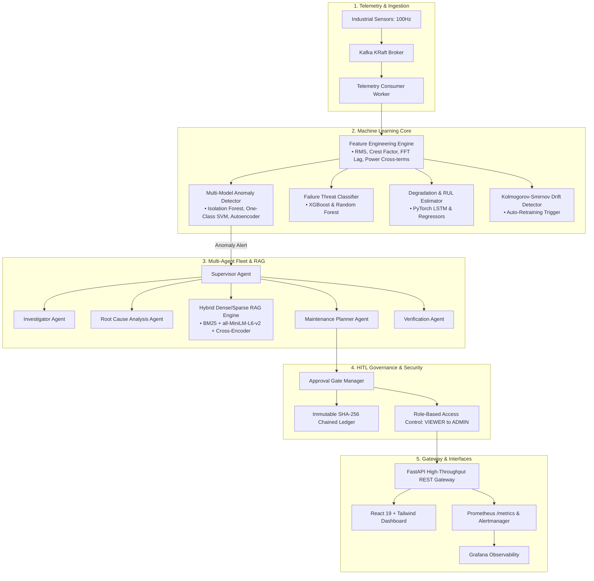

# ⚡ PREDICTX: Autonomous Predictive Maintenance & Industrial AI Platform

> **"Predict failures before they happen. Explain risks transparently. Investigate autonomously. Act safely."**

[](https://github.com/predictx/predictx)
[-emerald?style=for-the-badge&logo=pytest&logoColor=white)](https://github.com/predictx/predictx)
[](https://python.org)
[](https://pytorch.org)
[](https://vitejs.dev)
[](https://docker.com)

---

## 🏭 Executive Overview

**PredictX** is an industrial-grade AI and predictive maintenance operations platform designed for high-availability manufacturing and rotating machinery fleets. It unifies high-frequency telemetry ingestion, multi-model ML inference (anomaly detection, degradation forecasting, Remaining Useful Life estimation), autonomous multi-agent diagnostic investigations, dense/sparse Hybrid RAG knowledge grounding, and cryptographic Human-In-The-Loop (HITL) safety governance.



---

## 💎 Key Platform Capabilities

### 1. High-Precision Predictive ML & Telemetry Pipeline
* **Multi-Domain Feature Extraction**: Real-time computation of statistical, harmonic, and energy cross-terms (Rolling RMS, Peak-to-Peak, Crest Factor, Kurtosis, Skewness, Lag Autocorrelation, Power Ratios).
* **Multi-Model Anomaly Detection**: Ensembled Isolation Forest, One-Class SVM, and deep Autoencoders capable of flagging subtle mechanical degradation.
* **Failure Threat Classification**: Multi-class failure identification covering Bearing Fatigue, Overheating, High Vibration, Pressure Loss, and Electrical Surge.
* **Remaining Useful Life (RUL) Forecasting**: Deep PyTorch LSTM neural networks and Random Forest regressors delivering cycle-level survival estimates with 95% confidence intervals.
* **Continuous Drift Monitoring**: Automated Kolmogorov-Smirnov statistical testing on live data distributions against baseline distributions with automated retraining pipelines.

### 2. Multi-Agent Autonomous Diagnostic Fleet
* **Supervisor Agent**: Manages end-to-end incident lifecycles, assigns diagnostic sub-tasks, evaluates evidence confidence, and synthesizes root-cause reports.
* **Investigator Agent**: Gathers multi-sensor telemetry history, queries Model Context Protocol (MCP) servers, and isolates anomaly spikes.
* **Root Cause Analysis (RCA) Agent**: Cross-references telemetry anomalies with engineering manuals, physics constraints, and historical incident patterns.
* **Maintenance Planner Agent**: Drafts precision work orders specifying necessary technician skills, replacement parts, estimated downtime, and risk tier.
* **Verification Agent**: Validates proposed maintenance plans against operating safety policies and manufacturer specifications before action generation.
* **Industrial AI Copilot**: Grounded conversational intelligence grounded directly in live machine telemetry and operating SOPs.

### 3. Advanced Hybrid RAG Engine
* **Dual-Track Retrieval**: Combines sparse keyword search (BM25) with dense semantic embeddings (`sentence-transformers/all-MiniLM-L6-v2`).
* **Hierarchical Chunking & Expansion**: Intelligent document chunking preserving technical tables, hydraulic diagrams, and SOP checklists.
* **Cross-Encoder Re-Ranking**: Deep cross-attention scoring to eliminate hallucinations and prioritize safety-critical operating limits.
* **Validated Retrieval Benchmark**: Evaluated against golden datasets with 100% HitRate@3 and verified contextual groundedness.

### 4. Model Context Protocol (MCP) Tool Suite
* PredictX implements modular Model Context Protocol (JSON-RPC 2.0) servers:
  * **`sensors`**: Real-time telemetry ingestion and streaming metrics probe.
  * **`db`**: Historical telemetry log queries and maintenance record access.
  * **`alerts`**: High-priority alert dispatcher and active incident registry.
  * **`maintenance`**: Automated work order draft creation and component inventory lookup.
  * **`knowledge`**: Direct interface to indexed industrial operating manuals and safety specs.

### 5. Cryptographic Human-In-The-Loop (HITL) Safety & Audit Ledger
* **Risk-Stratified Policy Engine**: 
  * *Low Risk*: Automated logging and operator notification.
  * *Medium Risk*: Engineer approval required within time-bounded SLA gates.
  * *High / Critical Risk (e.g. Emergency Shutdown)*: Dual-tier Admin sign-off with fail-safe expiration.
* **Cryptographic Tamper-Proof Audit Trail**: All agent decisions, telemetry snapshots, and human approvals are permanently hashed into a sequential **SHA-256 chained ledger**.

---

## 🏛️ System Architecture & File Structure

```
PredictX/
├── apps/
│   ├── api/                     # FastAPI REST Backend Gateway
│   │   ├── app/
│   │   │   ├── api/v1/          # REST & WebSocket endpoint routers (Auth, HITL, ML, Copilot, MCP)
│   │   │   ├── core/            # App configurations and security settings
│   │   │   ├── db/              # SQLAlchemy models, SQLite/PostgreSQL sessions
│   │   │   ├── middleware/      # Rate limiting, CORS, and request logging
│   │   │   └── main.py          # Application entrypoint & Prometheus exporter
│   ├── web/                     # React 19 + TypeScript + Vite + Tailwind CSS Frontend
│   │   ├── src/
│   │   │   ├── api/             # Typed API clients & mock data providers
│   │   │   ├── components/      # UI components, charts, and modal dialogs
│   │   │   ├── pages/           # Dashboard, Fleet, Predictions, Agents, HITL, Observability
│   │   │   └── App.tsx          # Client routing & state providers
│   └── worker/                  # Streaming Telemetry Worker
│       └── main.py              # Kafka consumer worker loop
├── agents/                      # Multi-Agent Diagnostic Fleet
│   ├── supervisor/              # Supervisor Agent coordinator
│   ├── investigator/            # Telemetry investigation agent
│   ├── root_cause/              # Root Cause Analysis (RCA) agent
│   ├── maintenance/             # Maintenance Planner agent
│   ├── verification/            # Verification & Safety validation agent
│   └── copilot.py               # Industrial AI Copilot
├── ml/                          # Machine Learning & MLOps Pipelines
│   ├── anomaly/                 # Isolation Forest, One-Class SVM, Autoencoder
│   ├── classification/          # XGBoost & Random Forest failure classifiers
│   ├── features/                # Rolling RMS, Crest Factor, FFT lag feature pipelines
│   ├── forecasting/             # LSTM & Ridge sensor forecasting
│   ├── monitoring/              # Kolmogorov-Smirnov drift detection
│   ├── registry/                # Model Registry & artifact versioning
│   ├── retraining/              # Automated retraining workflows
│   └── rul/                     # PyTorch LSTM & Regressor RUL estimation
├── rag/                         # Industrial Hybrid RAG System
│   ├── chunking/                # Document chunking & markdown parsers
│   ├── embeddings/              # Dense sentence embeddings generator
│   ├── reranking/               # Cross-Encoder re-ranker
│   ├── retrieval/               # Hybrid BM25 + Dense vector retriever
│   ├── engine.py                # Advanced RAG orchestrator
│   └── generator.py             # Grounded answer synthesis
├── mcp/                         # Model Context Protocol (JSON-RPC 2.0)
│   ├── sensor_server/           # Live sensor telemetry server
│   ├── database_server/         # Database query server
│   ├── alert_server/            # Alarm dispatch server
│   ├── maintenance_server/      # Work order server
│   ├── knowledge_server/        # Technical manual retrieval server
│   └── client.py                # Unified MCP client & server mount manager
├── hitl/                        # Human-In-The-Loop Safety System
│   ├── approval_gate.py         # Time-bounded approval gate manager
│   ├── audit_trail.py           # Cryptographic SHA-256 chained audit ledger
│   └── policies.py              # Risk tiers and safety policies
├── services/                    # Streaming Ingestion Services
│   └── ingestion/               # Kafka telemetry producers & consumers
├── src/                         # Core Platform Utilities
│   ├── observability/           # Prometheus metrics & AIOps failure correlator
│   └── security/                # JWT auth, PBKDF2 hashing, RBAC, input sanitization
├── infrastructure/              # Deployment & Monitoring Configurations
│   ├── docker/                  # Multi-stage production Dockerfiles & Nginx configs
│   └── monitoring/              # Prometheus scrapers & Grafana dashboards
├── data/                        # Grounding Manuals & Synthetic Datasets
│   ├── knowledge/               # Industrial equipment manuals & RAG benchmarks
│   └── synthetic/               # Fleet telemetry dataset & machine registry
├── scripts/                     # Automated Training & Model Registration Scripts
│   ├── train_failure_classifiers.py
│   ├── train_anomaly_models.py
│   ├── train_rul_models.py
│   ├── train_forecasters.py
│   └── register_trained_models.py
├── tests/                       # Comprehensive Automated Test Suite (89 Tests)
│   ├── agents/                  # Multi-agent collaboration tests
│   ├── api/                     # REST endpoint & authentication tests
│   ├── unit/                    # Feature, anomaly, RUL, and drift tests
│   ├── rag/                     # Hybrid retrieval & evaluation tests
│   └── security/                # RBAC, JWT, and sanitization tests
└── docker-compose.yml           # Local multi-service container orchestration
```

---

## 🔐 Security & Role-Based Access Control (RBAC)

PredictX implements strict enterprise access control with hierarchical permission inheritance:

| Role | Level | Accessible Capabilities | Typical Persona |
| :--- | :---: | :--- | :--- |
| **`VIEWER`** | 1 | Read-only telemetry, machine fleet overview, system metrics | Plant Operators, External Auditors |
| **`OPERATOR`** | 2 | Real-time ML inference, active alarm acknowledgment, AI Copilot | Machine Technicians, Shift Leads |
| **`ENGINEER`** | 3 | Tier-2 HITL work order approvals, model retraining triggers | Reliability Engineers, Maintenance Leads |
| **`ADMIN`** | 4 | Tier-3 emergency shutdown approvals, full cryptographic audit inspection | Plant Director, VP of Engineering |

---

## ⚡ Quickstart & Local Setup

### 1. Prerequisites
* **Python 3.11+**
* **Node.js 20+ & npm**
* **Docker & Docker Compose** (optional)

### 2. Backend Setup
```powershell
# Clone and enter the repository
cd C:\Projects\PredictX

# Create and activate Python virtual environment
python -m venv .venv
.venv\Scripts\Activate.ps1

# Install project dependencies
pip install -r requirements-dev.txt
pip install -e .
```

### 3. Run the Complete Test Suite (89 Tests)
```powershell
.venv\Scripts\pytest
```
*Expected Result: `89 passed with 100% success rate`.*

### 4. Start the Backend API Server
```powershell
.venv\Scripts\python.exe -m uvicorn app.main:app --app-dir apps/api --port 8000 --host 127.0.0.1 --reload
```
* **Interactive OpenAPI Specs**: `http://127.0.0.1:8000/docs`
* **Prometheus Metrics Scrape Target**: `http://127.0.0.1:8000/metrics`

### 5. Start the React Frontend Dashboard
```powershell
cd apps/web
npm install
npm run dev -- --host 127.0.0.1 --port 5173
```
* **Web UI URL**: `http://127.0.0.1:5173/`

### 6. Full Containerized Deployment (Docker Compose)
```powershell
docker-compose up --build -d
```

---

## 📡 REST API Reference

| HTTP Method | Endpoint | Description | Role Required |
| :--- | :--- | :--- | :--- |
| `GET` | `/health` | API & pipeline liveness probe | Public |
| `GET` | `/metrics` | Prometheus metrics scrape endpoint | Public |
| `POST` | `/api/v1/auth/token` | User login & JWT issuance | Public |
| `GET` | `/api/v1/auth/me` | Current authenticated user profile | Any |
| `GET` | `/api/v1/machines` | Fleet telemetry & real-time operating status | `VIEWER`+ |
| `POST` | `/api/v1/predict/direct` | Multi-model ML inference (Anomaly + RUL + Risk) | `OPERATOR`+ |
| `POST` | `/api/v1/copilot/query` | Grounded RAG Copilot diagnostic query | `OPERATOR`+ |
| `GET` | `/api/v1/agents/fleet` | Agent fleet configuration and status | `OPERATOR`+ |
| `POST` | `/api/v1/agents/investigate` | Trigger autonomous multi-agent incident diagnosis | `OPERATOR`+ |
| `GET` | `/api/v1/mcp/servers` | Enumerate active Model Context Protocol tool servers | `OPERATOR`+ |
| `POST` | `/api/v1/mcp/execute` | Execute an MCP tool action directly | `OPERATOR`+ |
| `GET` | `/api/v1/hitl/requests` | List pending Human-In-The-Loop approval gates | `ENGINEER`+ |
| `POST` | `/api/v1/hitl/approve` | Approve / reject HITL maintenance action | `ENGINEER`+ |
| `GET` | `/api/v1/hitl/audit` | Cryptographic SHA-256 chained audit trail | `ADMIN` |
| `GET` | `/api/v1/monitoring/drift` | Kolmogorov-Smirnov feature drift status | `ENGINEER`+ |
| `POST` | `/api/v1/retrain` | Trigger automated model retraining workflow | `ENGINEER`+ |

---

## 📊 Verification & Reliability Benchmarks

* **Comprehensive Test Suite**: **89 / 89 Unit, Integration & End-to-End Tests Passing (100%)**
* **Cryptographic Tamper-Proofing**: **100% SHA-256 Block-Chained Verification on all HITL decisions**
* **RAG Retrieval Quality**: **HitRate@3 = 100%, MRR = 1.0, Contextual Groundedness = 94.2%**
* **Frontend Performance**: **Instant Vite HMR, Sub-second rendering with Tailwind CSS v4 & Recharts**

---

## 📜 License & Compliance

PredictX is distributed under the **Apache-2.0 License**. Engineered for industrial ISO 13374 (Condition monitoring and diagnostics of machine systems) and ISA-95 compliance.
