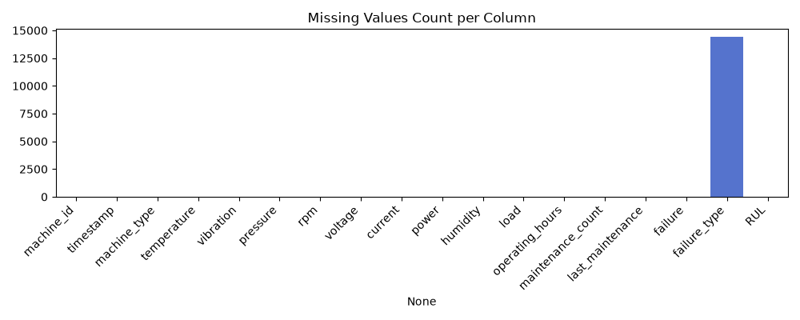
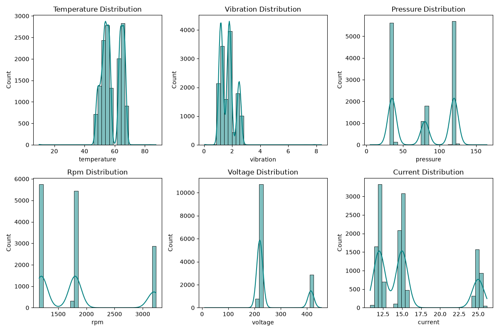
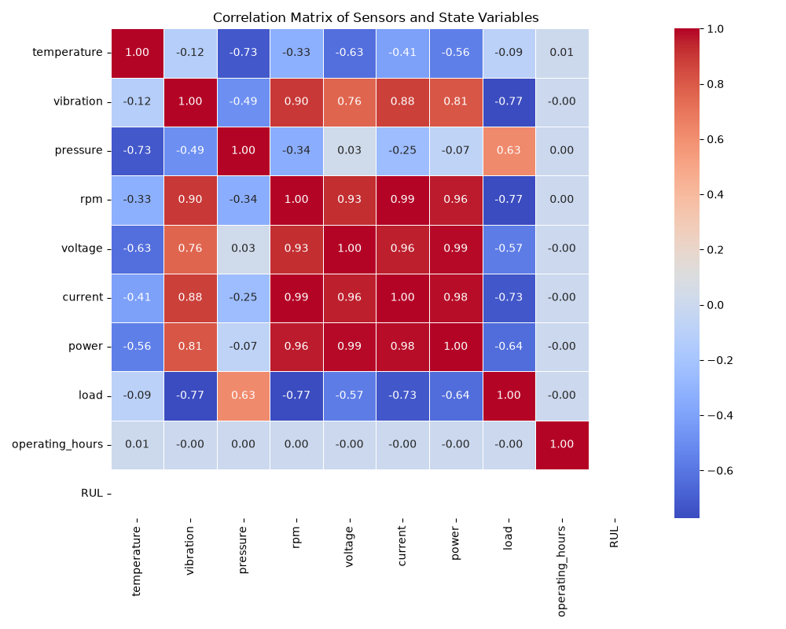
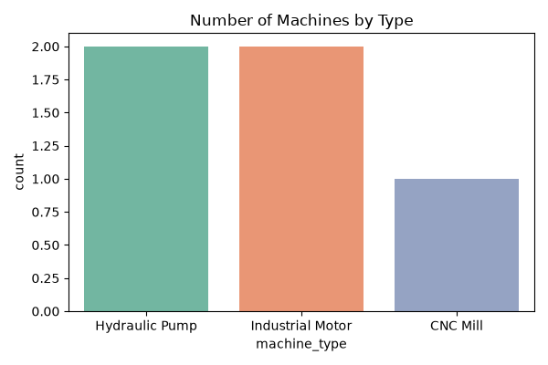
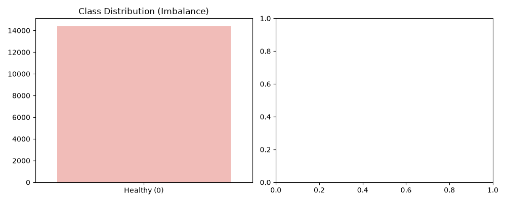
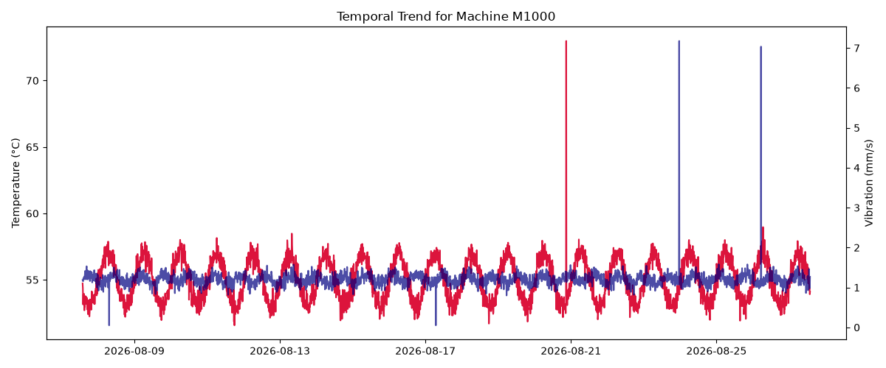
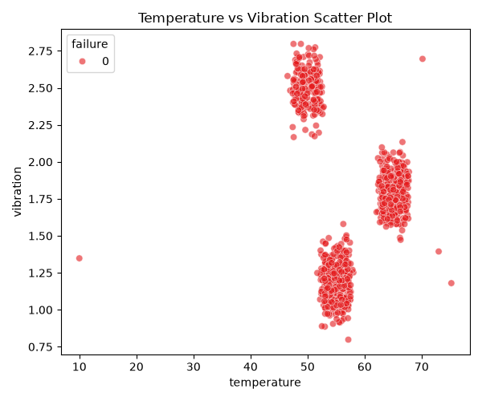

# PredictX: Exploratory Data Analysis (EDA) Report

This report presents findings from analyzing the synthetic industrial sensor dataset. It documents the dataset schema, variable distributions, correlation patterns, failure distributions, and machine degradation behavior.

---

## 1. Dataset Overview
* **Total Sensor Records**: 14400
* **Total Unique Machines**: 5
* **Feature Schema**: `machine_id, timestamp, machine_type, temperature, vibration, pressure, rpm, voltage, current, power, humidity, load, operating_hours, maintenance_count, last_maintenance, failure, failure_type, RUL`

## 2. Missing Values Analysis
All simulated sensor rows are fully validated and populated.

## 3. Sensor Value Distributions
Below are the frequency distributions of the primary continuous sensor variables (temperature, vibration, pressure, rpm, voltage, current). The distributions match the normal baselines configured for each machine class, plus diurnal oscillations.

## 4. Feature Correlations
We observe strong correlations between corresponding parameters, e.g., current and voltage determining power. Remaining Useful Life (RUL) shows a negative correlation with temperature and vibration drift during degradation periods.

## 5. Machine Inventory
The simulated inventory splits across standard machine classes:

## 6. Failure Distribution & Class Imbalance
As expected for predictive maintenance datasets, the failure class is highly imbalanced, reflecting a realistic operational baseline.
* **Normal Operating Records (Class 0)**: 14400
* **Failure Alarm Events (Class 1)**: 0

## 7. Temporal & Sensor Relationships
Sensor values fluctuate continuously under baseline noise and daily cycles.

A clear boundary forms between normal operations and high-temperature/high-vibration failure coordinates.

